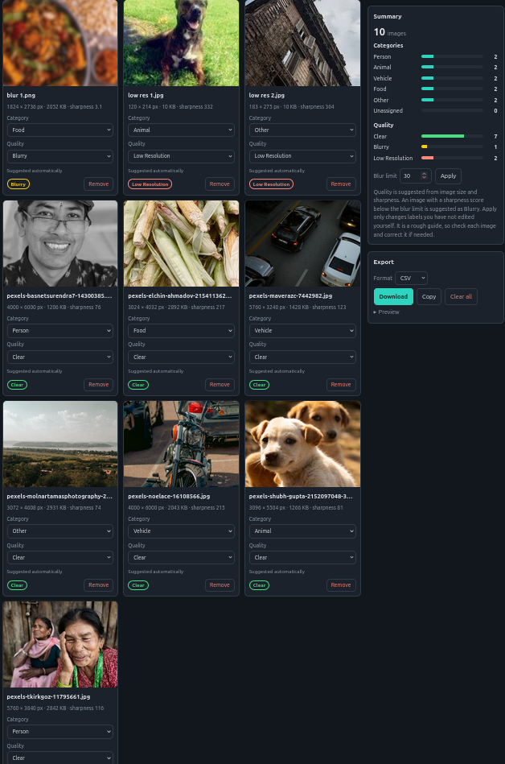
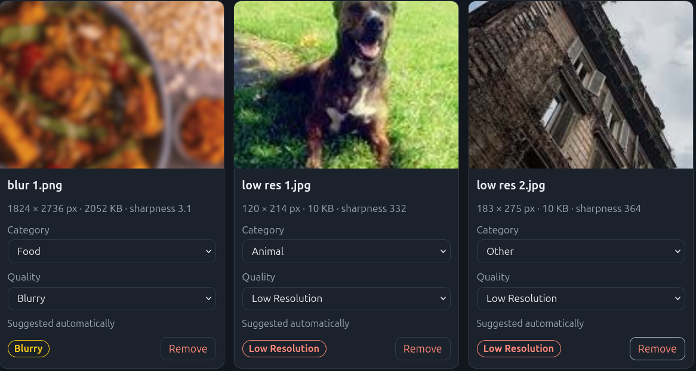
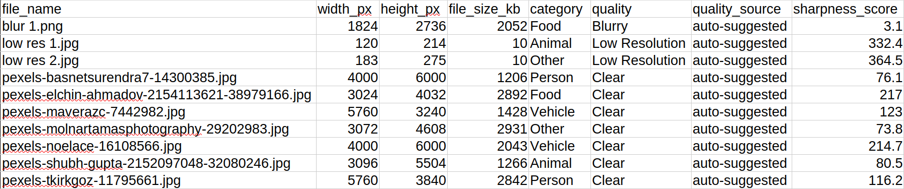

# Image Classification and Quality Checker

A simple browser tool to practice sorting images into categories and checking their quality. It runs fully in the browser. No backend, no API key. Images never leave your computer.

**Live demo:** https://mdshahedulislamsaim.github.io/image-quality-checker/

> This is an educational practice tool. The automatic quality suggestion is a simple estimate, not a certified quality check.

## Screenshots

**Image grid with categories and summary**

**Quality labels: Blurry and Low Resolution**

**CSV export**

Photos from [Pexels](https://www.pexels.com). Credit: PHOTOGRAPHER NAMES.

## What it does

- Upload many images at once, or drop them in
- Thumbnails with size, file size and a sharpness score
- Categories: Person, Animal, Vehicle, Food, Other
- Quality labels: Clear, Blurry, Low Resolution
- Edit any label at any time, or remove an image
- Summary of category and quality counts
- Export all labels as CSV or JSON

## How quality is suggested

1. If the shorter side is under 400 px, or the image has under about 0.25 megapixels, it is **Low Resolution**.
2. Otherwise the image is shrunk to 512 px and a sharpness score is measured (variance of the Laplacian). A score under 50 is **Blurry**.
3. Everything else is **Clear**.

The user can change every suggestion. The export shows whether a quality label was suggested or set by the user.

## Limits

- The blur limit is a starting value. I tried it on NUMBER sample images and it matched my own judgement on NUMBER of them. (Fill this in with your real numbers, or delete this line.)
- Plain images with little detail, such as a clear sky, can be marked Blurry even when they are sharp.
- Categories are never guessed. The user chooses them.

## Export format

CSV columns: `file_name, width_px, height_px, file_size_kb, category, quality, quality_source, sharpness_score`

JSON contains the same fields plus a summary of the counts.

## Built with

HTML, CSS and JavaScript in a single file.

## Credits

Built by YOUR NAME
